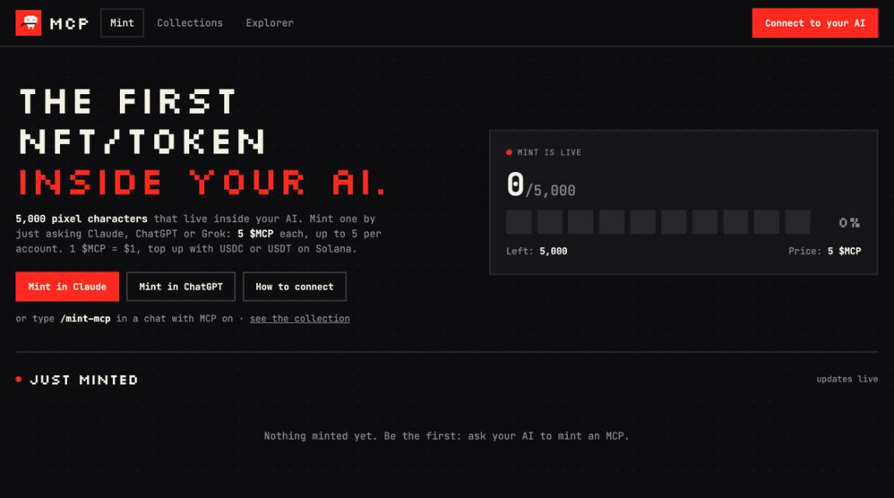

# $MCP: the first memecoin inside your AI


An NFT market that lives inside Claude and ChatGPT. You add one connector, sign in with X, and then just talk:
*"mint me an MCP"*, *"what's on the market under 10?"*, *"buy #0042"*, *"list my Scarf for 9"*, *"top up my balance"*

The website only shows the collection, prices and owners. Every action happens in your AI chat.

This repository is the whole server, so you can read exactly what the connector does before you plug it in.

> **Status: live on Solana mainnet, early launch.** Balances are real money: $MCP (1 $MCP = $1), topped up with USDC or USDT on Solana and withdrawn as USDC. Deposit only what you are ready to risk, and read [Honest risks](#honest-risks) first. Everything that happens is public in the [explorer](https://mcp.credit/#/explorer).



## Connect

**[➕ Add to Claude](https://claude.ai/customize/connectors?modal=add-custom-connector&connectorName=MCP&connectorUrl=https%3A%2F%2Fmcp.credit%2Fmcp)** opens Claude with the connector filled in: check the URL, press *Continue* → *Add* → *Connect*, sign in. Works on every Claude plan (the free plan allows one custom connector).

**Connector URL:** `https://mcp.credit/mcp`

- **Claude, by hand:** Customize → Connectors → *Add custom connector* → paste the URL → *Connect* → sign in.
- **ChatGPT:** Settings → Apps & Connectors → add a connector with the same URL → sign in.

Then say *"top up"* to get your personal Solana deposit address, send USDC or USDT to it, and start trading.

## What the connector can and can't do

These are all the tools the server exposes ([`server/src/mcp.js`](server/src/mcp.js)):

| Tool | What it does | Changes anything? |
|---|---|---|
| `account` | your MCP address, balance, deposit address, NFTs, recent balance changes, your page in the explorer | no |
| `public_profile` | show or hide your X handle on public pages (hidden by default) | your profile's visibility |
| `deposit` | your personal Solana address for USDC/USDT, and a check for new deposits | credits deposits that arrived |
| `faucet` | free test $MCP once a day (test server only) | your balance |
| `mint` | random NFT from the collection for 5 $MCP, max 5 per account | your balance, NFT owner |
| `my_nfts`, `market`, `nft` | look around | no |
| `buy` | buy a listed NFT; needs the exact price you agreed to | your balance, NFT owner |
| `sell`, `cancel_listing` | list your NFT or take it off sale | listing |
| `withdraw_form` | shows the withdrawal form in the chat (below) | no |
| `my_withdrawals` | your withdrawals, their status and transaction links | no |

**Withdrawals happen in a form, not by the AI.** The AI only opens the form ([MCP Apps](https://github.com/modelcontextprotocol/ext-apps), an interactive card inside Claude and ChatGPT). In it you paste your Solana wallet address and bind it **once**, enter the amount and press *Withdraw*, then *Confirm*: it arrives as USDC (1:1), the 0.5 $MCP fee is charged on top.
- The form's buttons are tools of their own (`withdraw_form_state`, `withdraw_form_bind`, `withdraw_form_submit`) marked `visibility: ["app"]`: apps that follow the MCP Apps spec keep them out of the AI's tool list, so the AI can't withdraw or bind an address, even if a web page or file tries to talk it into it.
- For apps that ignore that, the buttons also need the form's pass: a short-lived signed token that comes with the form in the tool result's `_meta`, which is for the form and not for the AI's context. The AI can't pre-fill an address either.
- Apps that can't show forms can't withdraw; use Claude (web, desktop, mobile) or ChatGPT.

**It can't:**
- see your chats, files, other connectors or anything outside this market;
- post on X, read your DMs or follow anyone: the X login asks only for `users.read tweet.read`, to learn your handle and avatar;
- send money at all: withdrawals need your click in the withdrawal form, and go only to the one address you bound there yourself. Changing it needs support.

**What the server stores:** your X id, handle, name and avatar; your balance, NFTs and a ledger of every balance change. OAuth codes and tokens are kept only as sha256 hashes. See [SECURITY.md](SECURITY.md) for the full list of protections.

## How it works

```
Claude / ChatGPT ──MCP over HTTPS──▶ /mcp ─┐
Your browser ──sign in──▶ /authorize, /login ─┤  one serverless function (Express)  ──▶  Postgres (Supabase)
Preview site ──▶ /api/* ───────────────────────┘
NFT images, site ──▶ CDN (static)
```

- **No blockchain for NFTs.** They are images on this server plus an owner row in the database. The chain is only the way in and out: deposit USDC or USDT on Solana, withdraw USDC back.
- **Balances are in $MCP, and 1 $MCP = $1.** You top up with USDC or USDT (1 token = 1 $MCP) and withdraw USDC. Amounts are stored as integer micro-units (6 decimals, exactly like USDC/USDT), so deposits are credited to the last unit.
- **Every balance change** writes a ledger row in the same database transaction, so balances always add up. The tests check this.
- **Market fee:** 2.5% of each sale goes to the treasury.

## Explorer

Everything that happens in the market is public at [`/#/explorer`](https://mcp.credit/#/explorer): deposits, mints, buys, withdrawals, fees. Code: [`server/src/explorer.js`](server/src/explorer.js).

- **MCP addresses, not X handles.** Every account has a public MCP address like `mcp_7Hq2kPzX9aBc`. It is an account number inside MCP, not a Solana wallet (the underscore makes sure it can't be pasted as one). Public pages and other users see the address; the X handle only if its owner turns it on (`public_profile` in the chat). That is not full anonymity: deposits and withdrawals are Solana transactions, so the wallets they come from and go to are public there.
- **The chain.** Every ledger row gets a number and a hash: `sha256(previous hash, number, row id, MCP address, amount, kind, reference, time)`, so changing, removing or inserting any past row breaks every hash after it. The database also refuses to change or delete ledger rows (trigger). The explorer page downloads the whole chain and recomputes every hash in your browser (*Verify the whole chain*); [`/api/explorer/chain`](https://mcp.credit/api/explorer/chain) is the raw data.
- **Anchors on Solana.** About once an hour, when there is something new, the payout wallet writes the latest hash to Solana as the memo `mcp:anchor:<network>:<number>:<hash>` (up to ~0.00001 SOL each). *Verify* reads the newest anchors straight from a Solana RPC in your browser and checks the memo and that the payout wallet signed it, so rewriting history up to an anchor, even with full database access, is caught; entries after the last anchor are covered once the next one lands. The payout wallet's history on Solscan lists every anchor ever made.
- **Proof of reserves.** What users are owed (the ledger's balances plus withdrawals not paid yet) next to the USDC and USDT held on Solana by the deposit addresses, the payout wallet and the owner's reserve wallets (`RESERVE_WALLETS`), every line linked to Solscan. Refreshed every 10 minutes. Reserve wallets are the owner's claim (Solscan shows their balance, not who controls them), so the page also shows the backing without them.
- **What it proves.** The chain shows history wasn't rewritten after the fact; the reserves show the money is there. Neither can show that a row was honest when it was written, but every deposit and withdrawal links to its Solana transaction.

## Deposits

Every account gets its **own Solana deposit address**. Send USDC or USDT there from any wallet or exchange; no memo, no extra step. 1 USDC = 1 USDT = 1 $MCP on your balance.

```
owner's computer, offline:  seed phrase (on paper) ──npm run deposit-pool──▶ 10,000 public addresses (CSV)
                                                                                    │ import
user's wallet / exchange ──USDC/USDT──▶ their address from the pool ◀── deposit_pool table
                                              │
     Helius webhook ──▶ /hooks/helius ────────┤   each one fetches the transaction from the chain itself,
     "check my deposit" ──▶ deposit tool ─────┤   checks mint, owner and amount, and credits it once
     every 5 min ──▶ scheduled function ──────┘
```

- **The server can't move deposits.** Addresses are made in advance on the owner's computer from a seed phrase that stays on paper ([`server/scripts/deposit-pool.js`](server/scripts/deposit-pool.js)). The server only gets public addresses, hands one to each user and watches them. There is no key on the server to sign a transfer with, so even a full takeover of the server and the database can't take deposited funds. Wallet *n* is `m/44'/501'/n'/0'`, the path Phantom and Solflare use, so the phrase alone recovers everything.
- **Addresses can't be swapped.** Every address in the pool is signed (HMAC) with `DEPOSIT_POOL_KEY`, which the script derives from the phrase. The server shows and credits only addresses whose signature checks out, so someone who can write to the database can't slip in an address of their own.
- **What gets credited.** Only the real USDC and USDT mints, only into the token account of the user's own pool address, only successful transactions, only the amount the chain shows. The webhook payload is never trusted: it only says which transaction to look at. Each (transaction, token account) pair is credited at most once, enforced by a unique key. Amounts below 0.01 (spam "dust") are recorded and not credited.
- **Not lost if something fails.** Helius retries a webhook only three times, so the deposit tool checks on demand and a scheduled function (every 5 minutes, [`netlify/functions/deposits.mjs`](netlify/functions/deposits.mjs)) scans everyone who asked for an address in the last 2 hours, plus a rotating slice of everyone else.
- **Test server = devnet.** With `TEST_MODE=1` deposits are Solana devnet only (free USDC at [faucet.circle.com](https://faucet.circle.com)); the real server takes mainnet only. Mixing free test money with real money is refused at startup. Use different phrases for the two.
- **The webhook sets itself up.** The scheduled function creates one Helius webhook pointing at `/hooks/helius` and keeps its address list in sync.

### Making the address pool

On your own computer, with the repo cloned and `npm install` done (Wi-Fi can be off):

```bash
npm run deposit-pool -- --network mainnet          # new 24-word phrase, addresses #0..#9999
npm run deposit-pool -- --network mainnet --start 10000   # later: the next 10,000, same phrase
```

1. Write the 24 words on paper. They never go into a chat, a website, Netlify or the cloud.
2. Put the printed `DEPOSIT_POOL_KEY` into Netlify (it can't move money; it only signs the list).
3. Supabase → Table Editor → `deposit_pool` → Insert → *Import data from CSV* → the file the script wrote.

The scheduled function reports how many free addresses are left and warns when the pool runs low.

Code: [`server/src/deposits.js`](server/src/deposits.js), [`server/src/solana.js`](server/src/solana.js).

## Withdrawals

Say *"withdraw"* (or *"withdraw 50"*) and the chat shows the withdrawal form. Paste your Solana wallet address and press *Bind* once, then enter the amount and press *Withdraw* → *Confirm*. The USDC arrive at that address, usually within a minute, and the form shows the transaction. The fee is 0.5 $MCP on top; the minimum is 5 $MCP. A newly bound address can receive 24 hours after binding.

```
deposit addresses (offline phrase) ──npm run sweep, on the owner's computer──▶ hot wallet ──USDC──▶ user's bound address
                                                                                  ▲ the only key on the server
```

- **Two wallets.** Deposits stay in the pool addresses, which only the paper phrase controls. Payouts come from a separate **hot wallet** whose key is in `WITHDRAW_WALLET_KEY`, holding a small float (say 500 USDC and 0.1 SOL for fees). A full server takeover can take at most what is on the hot wallet. The owner tops it up with `npm run sweep` ([`server/scripts/sweep.js`](server/scripts/sweep.js)), which moves deposits to any address and pays network fees from a "fees wallet" made from the same phrase.
- **Limits.** Paid automatically up to 100 $MCP per withdrawal, 300 per user per day and 1,000 per day in total. Anything above waits for the owner (`status = 'review'`). On top of that, a hard cap (2,000 a day by default) holds for everything, approved or not.
- **Never twice.** Every signed transaction is stored (`withdrawal_attempts`) before it is broadcast and can't be changed or deleted afterwards. A new one is made only when every earlier one is dead: the *finalized* block height is past its last valid height plus a margin, and a status lookup from a node at least that current shows it never landed. Until then the same bytes are rebroadcast, and those can land only once. Any error from the network counts as "maybe received", and every decision is re-checked under a row lock. Only signatures the server stored itself are trusted; the memo `mcp:w:<network>:<id>` on each payout is just for people reading the chain.
- **Safe to edit by hand.** In the table editor, `sent` and `refunded` are final, and amount, fee, address and user of a withdrawal can't be changed (database triggers).
- **Signed rows.** Withdrawal rows and address bindings are signed (HMAC, key derived from `DEPOSIT_POOL_KEY`), and a withdrawal needs the user's balance to match their ledger. A row created or changed straight in the database is not paid, and replacing the hot wallet invalidates nothing. Someone with full control of the database could still inflate the balance of an account of their own and withdraw it; the hard daily cap and the hot wallet float limit that.
- **Address safety.** The bound address can't be changed by the user, can't be a token account (funds sent "to" one would be lost) or one of the market's own addresses, and on the real server the first withdrawal opens 24 hours after binding.
- **If the hot wallet runs low**, withdrawals wait in the queue and the scheduled run logs an alert; nothing is lost.

**For the owner**, in Supabase → Table Editor → `withdrawals`:
- approve a withdrawal waiting for review: set `status` to `pending` (it goes out within 5 minutes);
- refuse it: set `status` to `rejected`; within 5 minutes (or once a transaction already sent for it can no longer land) amount and fee go back to the user and the status becomes `refunded`;
- a payout that gave up after 5 tries shows `status = 'review'` with the reason in `error`; to try again set `status` to `pending` and `attempts` to `0`;
- replace the hot wallet: put the new key in `WITHDRAW_WALLET_KEY` and redeploy; queued withdrawals are paid from the new one;
- emergency stop: set `WITHDRAWALS_PAUSED=1` in Netlify and redeploy.

```bash
npm run sweep -- --network mainnet --to <hot wallet or your own wallet>          # look: what is where
npm run sweep -- --network mainnet --to <hot wallet or your own wallet> --send   # move it
```

The destination can't be one of the pool's own addresses (Phantom's "Account 1, 2…" of the deposit phrase) or the fees wallet; the script refuses them.

Code: [`server/src/withdrawals.js`](server/src/withdrawals.js), [`server/src/tx.js`](server/src/tx.js) (Solana transactions without an SDK, checked against `@solana/web3.js`).

```
server/src/
  app.js      HTTP routes: /mcp, OAuth, public API, explorer API, Helius webhook, manual credit
  mcp.js      the tools listed above, and the withdrawal form as an MCP App
  ui.js       builds the withdrawal form with the MCP Apps SDK built in (pinned by sha256)
  market.js   rules: balances, mint, listings, buys, MCP addresses
  explorer.js public explorer: hash chain, Solana anchors, proof of reserves
  withdrawals.js payouts: limits, hot wallet, never-twice sending, refunds
  tx.js       Solana transaction building and signing
  money.js    $MCP amounts <-> micro-units
  deposits.js USDC/USDT deposits: address assignment, chain checks, webhook, scheduled scan
  pool.js     the offline-made deposit address pool and its HMAC
  solana.js   address derivation, token accounts, Solana RPC, Helius webhook API
  auth.js     OAuth for the connector + X sign-in
  schema.js   database tables and one-time data migrations
  lambda.js   serverless entry (Netlify Functions)
  cron.js     scheduled entry every 5 minutes: deposit scan, payouts, explorer
  index.js    plain Node entry (npm start)
server/ui/    the withdrawal form (HTML)
site/         the preview website and the explorer
collection/   NFT images and traits
netlify/      Netlify function wrapper
```

## Run it locally

Node 22+.

```bash
npm install
cp .env.example .env      # test mode, embedded database, no setup needed
npm run demo              # optional: 8 fake traders so the site has something to show
npm start                 # http://localhost:3000, connector at http://localhost:3000/mcp (also runs the 5-minute deposit/payout job)
npm test                  # end-to-end tests: real OAuth, real MCP client, two users trading
```

## Deploy your own

1. **Database:** create a Supabase project. Copy *Connect → Transaction pooler* URI (port 6543). Tables are created on first start.
2. **Netlify:** import this repo. Build settings come from `netlify.toml`. Set the environment variables:

| Variable | Value |
|---|---|
| `PUBLIC_URL` | `https://<your-site>.netlify.app` |
| `DATABASE_URL` | the Supabase pooler URI |
| `TEST_MODE`, `DEV_LOGIN` | `1` for a test server; remove both for production |
| `X_CLIENT_ID`, `X_CLIENT_SECRET` | X app with OAuth 2.0, callback `PUBLIC_URL/login/x/callback` |
| `HELIUS_API_KEY` | from [helius.dev](https://helius.dev); used for Solana RPC and the deposit webhook |
| `DEPOSIT_POOL_KEY` | printed by `npm run deposit-pool` (see *Making the address pool*); then import the CSV into `deposit_pool` |
| `WITHDRAW_WALLET_KEY` | the payout hot wallet's secret key (Phantom: *Export private key*). Keep only a small float on it. Withdrawals also need `DEPOSIT_POOL_KEY` (or `WITHDRAW_MAC_KEY`), which signs withdrawal rows |
| `ADMIN_TOKEN` | optional: long random secret for manual credits (`POST /admin/deposit`); unset means off |
| `MINT_PRICE_USD`, `MIN_DEPOSIT_USD`, `FAUCET_USD` | optional, in $MCP (= USD), defaults 5, 0.01, 20 |
| `MIN_WITHDRAW_USD`, `WITHDRAW_FEE`, `WITHDRAW_AUTO_MAX`, `WITHDRAW_USER_DAILY`, `WITHDRAW_DAILY`, `WITHDRAW_HARD_DAILY` | optional, defaults 5, 0.5, 100, 300, 1000, 2000 |
| `WITHDRAW_ADDRESS_DELAY_HOURS`, `WITHDRAWALS_PAUSED` | optional: hours before a new address can receive (24; 0 on the test server), `1` stops payouts |
| `RESERVE_WALLETS` | optional: your cold wallets holding swept deposits (public addresses, comma-separated), so the explorer counts them as reserves |
| `ANCHOR_EVERY_MINUTES`, `ANCHORS_OFF`, `RESERVES_EVERY_MINUTES` | optional: how often the chain's hash goes to Solana (60), `1` stops anchors, how often reserves are read (10) |

Deposits start working once `HELIUS_API_KEY` and `DEPOSIT_POOL_KEY` are set (and deployed) and the pool CSV is imported; the scheduled function registers the Helius webhook within 5 minutes of the first address handed out.

3. Smoke-test it: `npm run smoke -- https://<your-site>.netlify.app`

## Roadmap

- [x] Market, mint, OAuth connector, preview site, test server
- [x] Real X sign-in on the public server
- [x] Balances in $MCP, 1 $MCP = $1
- [x] Deposits: USDC/USDT on Solana to personal addresses, Helius webhook + scheduled scan
- [x] Withdrawals: hot wallet with limits, review queue, sweep script for the owner
- [x] Withdrawal form inside the chat (MCP Apps): the user presses the buttons, not the AI
- [x] Public explorer: MCP addresses, hash chain, anchors on Solana, proof of reserves
- [x] Live on Solana mainnet at [mcp.credit](https://mcp.credit)
- [ ] Final collection

## Honest risks

- **Custodial.** Deposited tokens sit in addresses the project controls through one offline seed phrase, and the database is the source of truth for balances. Whoever holds the paper holds the funds.
- **Whoever controls the deployed code** (Netlify or GitHub accounts) could show users a different deposit address for new deposits. Those accounts need two-factor sign-in.
- **NFTs live on this server.** They exist as long as the server does.
- **Bots.** A server can't prove a request came from a human in Claude. Defenses: X sign-in, minimum account age, per-account mint limits.

## License

[MIT](LICENSE)
